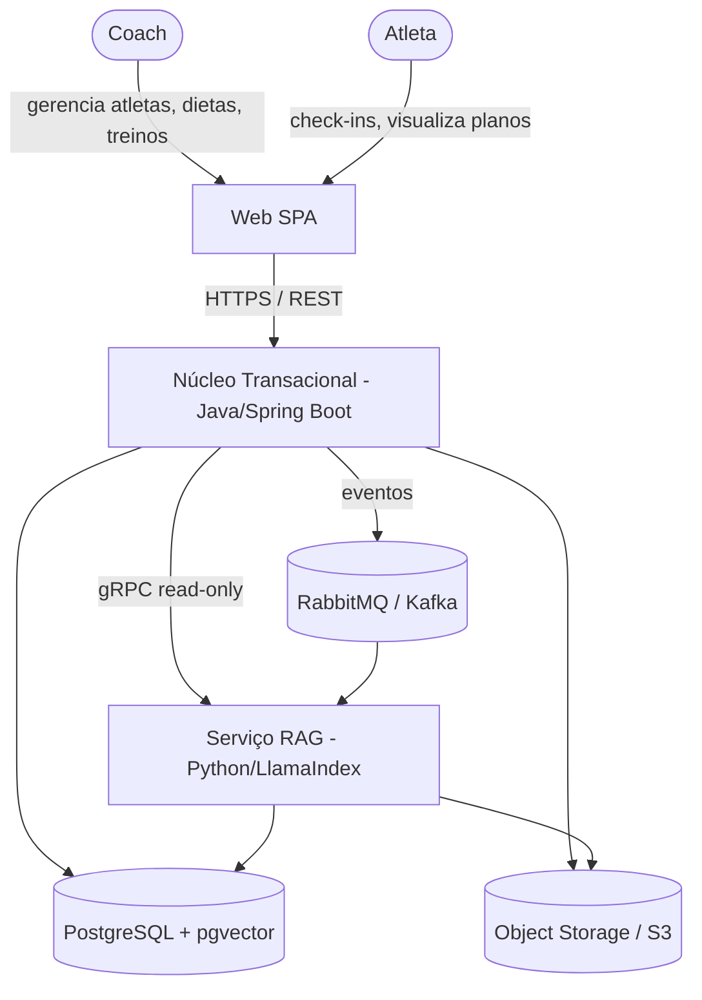
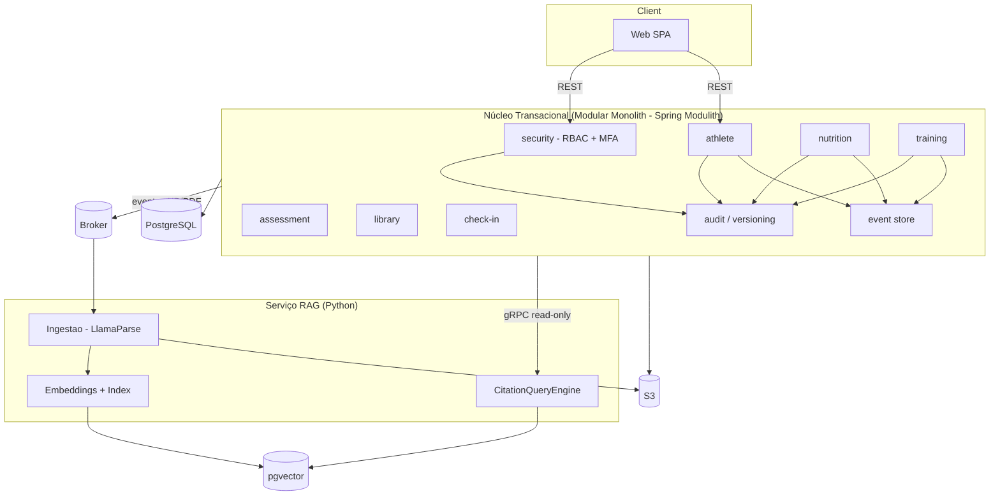
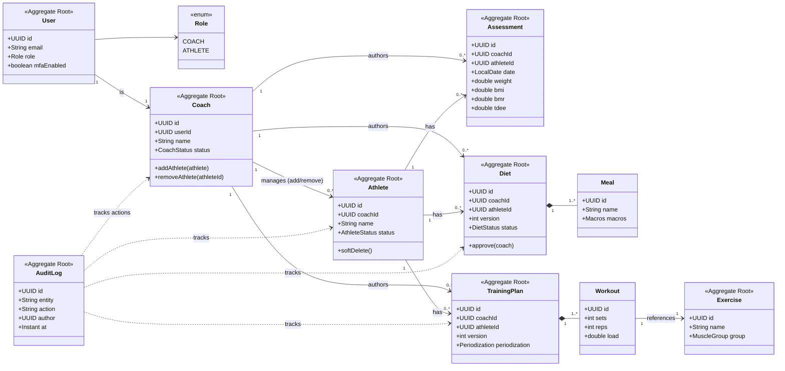
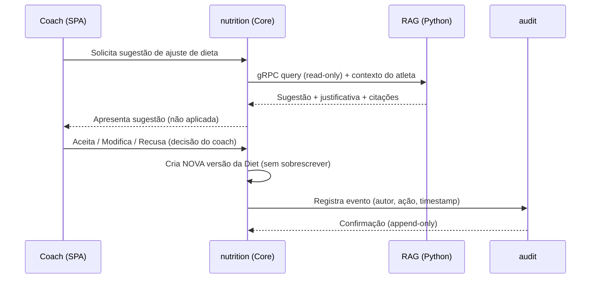
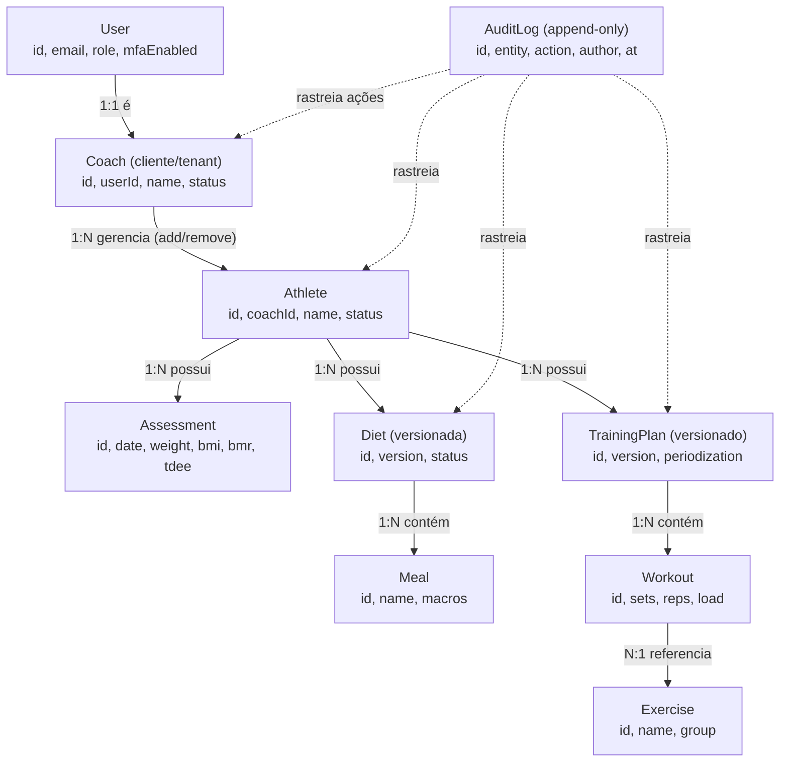
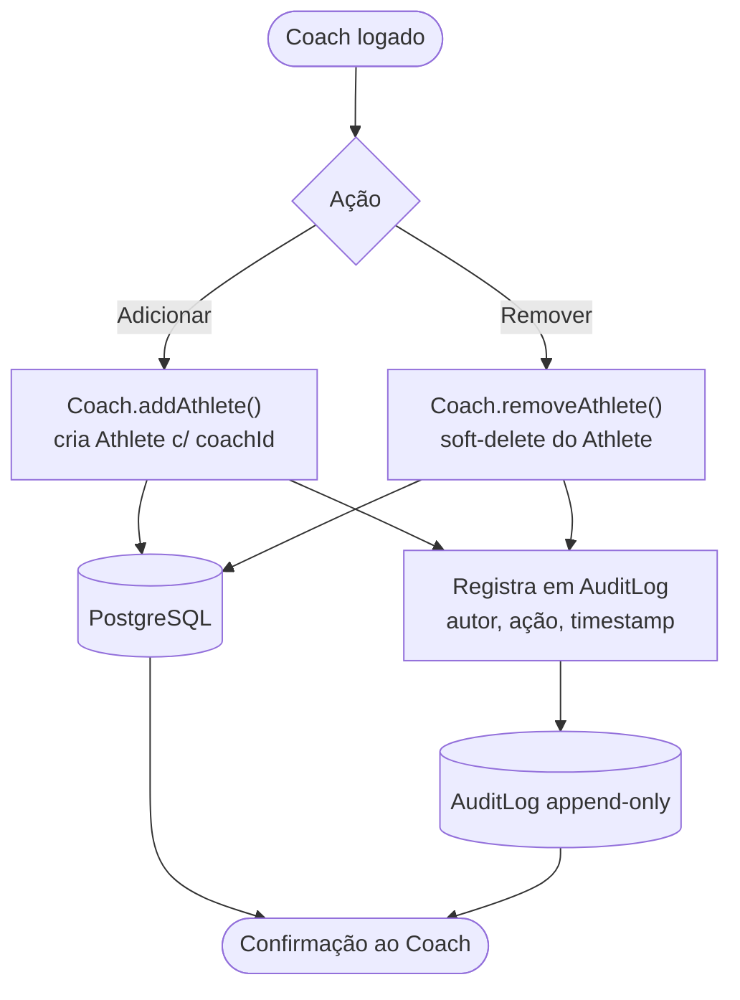
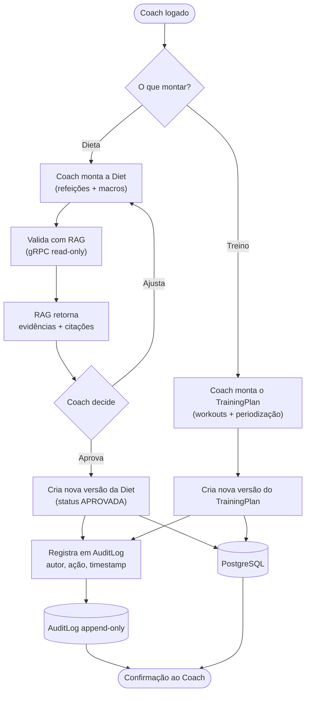

# ProCoach — System Design, Arquitetura & UML

> Plataforma **coach-led**, baseada em evidências, com alta rastreabilidade e auditabilidade.
> Núcleo transacional em **Java 21 + Spring Boot 3.x** (Modular Monolith / Spring Modulith) e serviço de IA (RAG) **read-only** em Python + LlamaIndex.

---

## 1. Princípios Arquiteturais

- **A plataforma não substitui o coach.** A IA apenas sugere, justifica e cita evidências.
- **A decisão final sempre pertence ao coach.**
- **Alterações nunca serão sobrescritas** — versionamento + auditoria imutável são obrigatórios.
- **DDD**, **Clean Architecture**, **SOLID**, **Clean Code** e **Event-Driven Architecture**.
- Serviço RAG **stateless e read-only** (nunca escreve no domínio).

---

## 2. Visão de Contexto (C4 - Nível 1)

---

## 3. Arquitetura de Contêineres (C4 - Nível 2)

---

## 4. UML de Domínio (Class Diagram - DDD)

Cada **Aggregate Root** corresponde à raiz de um bounded context (módulo Spring Modulith).
`Diet` e `TrainingPlan` são **versionados** (nunca sobrescritos). `AuditLog` rastreia as entidades críticas.

---

## 5. Bounded Contexts / Módulos

| Módulo (package) | Agregado raiz | Épico | Responsabilidade |
|---|---|---|---|
| `com.procoach.core.security` | User/Role | E9 | Autenticação, MFA, RBAC (Coach × Atleta) |
| `com.procoach.core.audit` | AuditLog | E10 | Log imutável append-only + versionamento (cross-cutting) |
| `com.procoach.core.coach` | Coach | E0/E1 | Cliente da plataforma (tenant); gerencia (adiciona/remove) seus atletas |
| `com.procoach.core.athlete` | Athlete | E1 | Cadastro, status, soft-delete, múltiplos protocolos |
| `com.procoach.core.assessment` | Assessment | E2 | Avaliação física + cálculos (IMC, TMB, TDEE) |
| `com.procoach.core.nutrition` | Diet | E3 | Dietas versionadas + workflow de aprovação |
| `com.procoach.core.training` | TrainingPlan | E4 | Periodização, séries/reps/carga |
| `com.procoach.core.library` | Exercise | E8 | Biblioteca de exercícios |
| `com.procoach.core.checkin` | CheckIn | E5 (MVP2) | Envios do atleta + análise comparativa por IA |

---

## 6. Fluxo: Aprovação de Dieta com Sugestão da IA (coach-led)

---

## 7. Decisões de Arquitetura (ADRs)

| ADR | Decisão |
|---|---|
| ADR-001 | Modular monolith em Java/Spring Boot com Spring Modulith |
| ADR-002 | Event Sourcing seletivo para agregados críticos (Diet, TrainingPlan) |
| ADR-003 | Serviço RAG Python isolado, read-only e stateless |
| ADR-004 | LlamaIndex + LlamaParse para parsing de PDFs e respostas com citações |
| ADR-005 | Entrega web-first; app mobile em fase posterior |

---

## 8. Stack Tecnológica

| Camada | Tecnologia |
|---|---|
| Núcleo transacional | Java 21 + Spring Boot 3.x |
| Modularização | Spring Modulith |
| Persistência | JPA/Hibernate + Flyway |
| Event Sourcing / CQRS | Axon Framework (ou event store manual em PostgreSQL) |
| Segurança | Spring Security (RBAC + MFA) |
| Mensageria | RabbitMQ / Kafka |
| Banco de dados | PostgreSQL + pgvector |
| Object storage | S3-compatível (MinIO / AWS S3) |
| Serviço RAG | Python + LlamaIndex + LlamaParse |
| Comunicação Core <-> RAG | gRPC (read-only) |
| Frontend (MVP) | Web SPA |

---

## 9. Estratégia de Persistência & Auditoria

- **PostgreSQL** para dados relacionais; **pgvector** para busca vetorial (embeddings da base científica).
- **Versionamento**: agregados críticos guardam `version`, `author`, `timestamp` e histórico; nova alteração = nova versão.
- **AuditLog append-only**: nenhum registro é atualizado ou removido — apenas inserido.
- **Soft-delete**: exclusões são lógicas, preservando rastreabilidade.

---

## 10. Roadmap

- **MVP (v1.0)** — Fundação + E1, E2, E3, E4, E8, E9, E10 (Web, sem IA/RAG).
- **MVP2 (v1.1)** — E7 Knowledge Base, E6 RAG/IA (sugestões com citações), E5 Check-ins.
- **Pós-MVP2** — App mobile, analytics avançado, expansão para outros nichos esportivos.

---

## 11. Dicionário de Domínio (Objetivo de cada Classe)

### Aggregate Roots (raízes dos bounded contexts)

- **`User`** (`security`) — Representa qualquer pessoa autenticada (coach ou atleta). Centraliza identidade, credenciais, MFA e o papel (`Role`) que determina as permissões (RBAC). Ponto de entrada da autorização: garante que o atleta só acesse os próprios dados.
- **`Coach`** (`coach`) — **É o nosso cliente** (tenant) e o dono do relacionamento com os atletas. Um coach pode ter **N atletas** e é o único autorizado a **adicionar** (`addAthlete`) ou **remover** (`removeAthlete`) atletas da sua carteira. Toda ação do coach (adicionar/remover atleta, aprovar dieta, editar treino) é registrada no `AuditLog` — quem, o quê e quando. É também o **autor ativo** do conteúdo: **monta a dieta**, **valida com o RAG** (consulta read-only para checar evidências antes de aprovar) e **monta os treinos**. O RAG apenas sugere/valida — a decisão e a autoria são sempre do coach. Vinculado a um `User` (papel `COACH`) para autenticação/autorização.
- **`Athlete`** (`athlete`) — Núcleo do negócio: o atleta acompanhado pelo coach. Mantém dados cadastrais, status (ativo/pausado/arquivado) e serve de âncora para avaliações, dietas e treinos. Suporta **soft-delete** (`softDelete()`) para preservar rastreabilidade — nada é apagado fisicamente.
- **`Assessment`** (`assessment`) — Uma avaliação física em data específica. Registra medidas (peso, etc.) e calcula automaticamente indicadores (`bmi`, `bmr`, `tdee`), permitindo acompanhar a evolução ao longo do tempo. Cada avaliação é imutável — nova medição gera novo registro.
- **`Diet`** (`nutrition`) — Plano alimentar **versionado** do atleta. Guarda a dieta com `version` e `status`, passando por workflow de aprovação (`approve(coach)`). Regra central: **alterações nunca sobrescrevem** — cada ajuste cria nova versão, e a decisão final é sempre do coach.
- **`TrainingPlan`** (`training`) — Plano de treino **versionado** com periodização. Organiza a programação de treinos ao longo de ciclos (`periodization`). Mantém histórico versionado e auditável.
- **`Exercise`** (`library`) — Catálogo reutilizável de exercícios. Fornece uma biblioteca padronizada (nome, grupo muscular) que os treinos referenciam, evitando duplicação e garantindo consistência.
- **`AuditLog`** (`audit` — cross-cutting) — Registro imutável **append-only** de tudo que acontece no sistema. Garante auditabilidade total: quem fez (`author`), o quê (`action`), em qual entidade (`entity`) e quando (`at`). Espinha dorsal da rastreabilidade.

### Entidades internas (parte de um agregado)

- **`Meal`** (dentro de `Diet`) — Uma refeição dentro de uma dieta. Detalha itens e macronutrientes (`Macros`). Não existe isolada — pertence sempre a uma `Diet`.
- **`Workout`** (dentro de `TrainingPlan`) — Um exercício prescrito dentro de um plano de treino. Define a execução concreta (séries, repetições, carga) e referencia um `Exercise` da biblioteca.

### Value Objects / Enums

- **`Role`** (enum) — Define o papel do usuário (`COACH` ou `ATHLETE`). Dirige as regras de RBAC e separa o que cada tipo de usuário pode ver e fazer.
- **`Macros`** — Value object com a composição de macronutrientes (proteínas, carboidratos, gorduras) de uma refeição.
- **`CoachStatus`** (enum) — Estados válidos do coach/cliente (ex.: ATIVO, SUSPENSO, CANCELADO).
- **`AthleteStatus`** (enum) — Estados válidos do atleta (ex.: ATIVO, PAUSADO, ARQUIVADO).
- **`DietStatus`** (enum) — Estados do workflow da dieta (ex.: RASCUNHO, PENDENTE, APROVADA).
- **`Periodization`** — Value object que descreve o tipo/estrutura de periodização do treino.
- **`MuscleGroup`** (enum) — Grupos musculares usados para classificar exercícios.

> Os value objects/enums dão semântica de domínio em vez de tipos primitivos soltos — reforçando *Clean Code* e DDD.

---

## 12. Diagramas em `graph TD`

### 12.1 Modelo de Domínio — relacionamentos entre entidades

### 12.2 Fluxo — Coach adiciona / remove atleta (com auditoria)

---

## 13. Fluxo — Coach monta dieta/treino e valida com RAG (coach-led)

O coach é o **autor**; o RAG é **consultivo e read-only** (valida evidências, nunca decide nem escreve no domínio).

### Regras reforçadas
- O **coach monta** a dieta e o treino — o sistema não gera automaticamente.
- O **RAG valida** (read-only): retorna evidências e citações, mas **não altera** o domínio.
- A **decisão final é do coach**; cada aprovação/ajuste gera **nova versão** (nunca sobrescreve).
- Toda ação é registrada no **AuditLog** (append-only).
