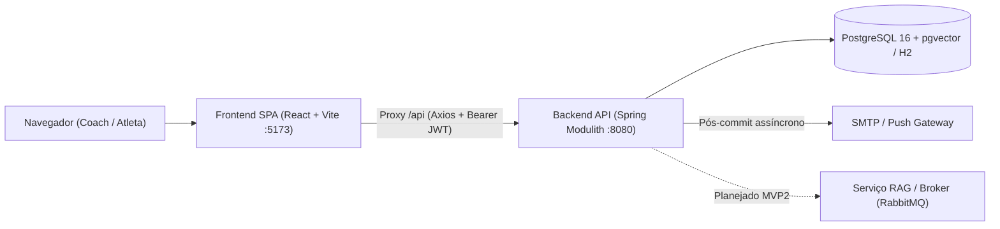
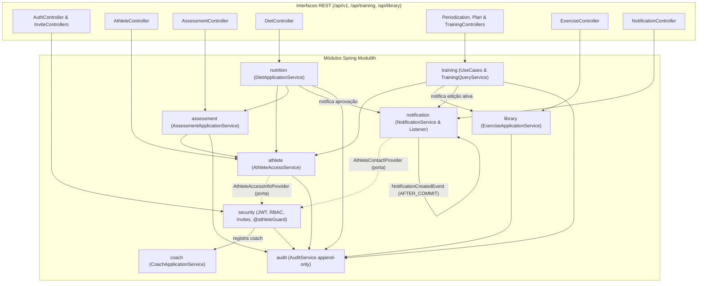
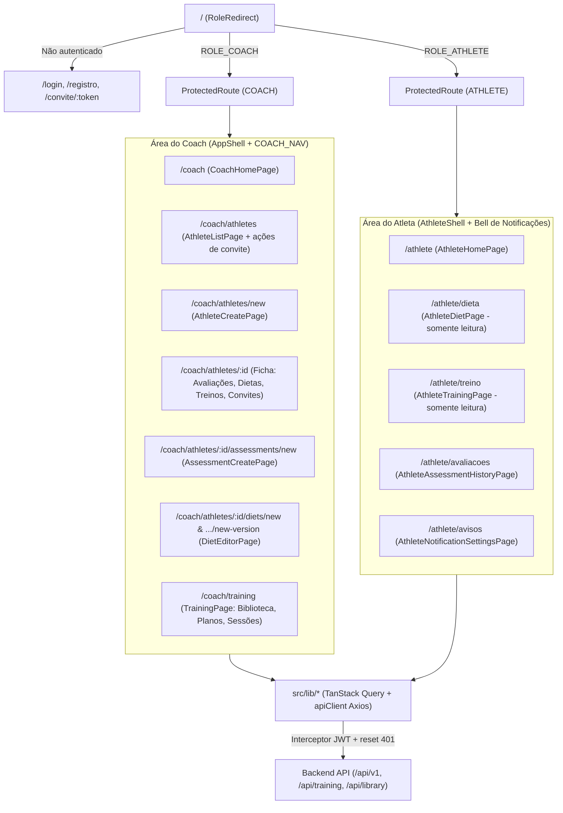

# ProCoach

Plataforma para **coaches** de treinamento e nutrição gerenciarem **atletas**, avaliações físicas, dietas versionadas, periodizações/treinos e notificações, com isolamento multi-tenant por coach e auditoria imutável de alterações.

---

## Estrutura do Repositório

| Caminho | Descrição |
| :--- | :--- |
| `backend/` | API REST em Java 17 + Spring Boot + Spring Modulith (porta `8080`) |
| `frontend/` | SPA em React + TypeScript + Vite (porta `5173`, proxy `/api -> localhost:8080`) |
| `docs/` | Especificações de domínio (`nutricao-plano-alimentar.md`) e configuração de agentes (`docs/agents/`) |
| `TASKS.md` | Backlog transversal (QA, E2E integrado e UAT); backlogs específicos ficam em `backend/TASKS.md` e `frontend/TASKS.md` |
| `AGENTS.md` | Regras raiz para skills de engenharia (issue tracker, triagem e docs de domínio) |

---

## Stack Tecnológica

- **Backend:** Java 17, Spring Boot 4.1.2, Spring Modulith 2.1.2, Spring Data JPA, Flyway (19 migrações `V100`–`V806`), Spring Security + OAuth2 Resource Server (JWT HMAC SHA-256), PostgreSQL 16 (`pgvector/pgvector:pg16` no `docker-compose.yml`) / H2 (perfil `h2`), Spring Mail, AMQP (RabbitMQ starter), SpringDoc OpenAPI (`/swagger-ui.html`), Testcontainers.
- **Frontend:** React 19, TypeScript 5.9, Vite 8, React Router 7, TanStack Query 5, Axios, React Hook Form + Zod, Recharts, `qrcode`, Vitest + Testing Library, Playwright, ESLint.

---

## Arquitetura Geral



---

## Arquitetura do Backend (Spring Modulith)

O backend é estruturado em **9 módulos** sob `com.fitness.procoach`, validados por `ModulithArchitectureTest`. A comunicação entre módulos ocorre apenas por fachadas públicas de aplicação, portas (interfaces invertidas) e eventos pós-commit (`@TransactionalEventListener(AFTER_COMMIT)`).



### Módulos do Backend

| Módulo | Responsabilidade | Rotas Base |
| :--- | :--- | :--- |
| `security` | Autenticação JWT (login/register/refresh), RBAC (`ROLE_COACH`, `ROLE_ATHLETE`), `@athleteGuard`, MFA (desligado por flag), convites de uso único (7 dias) | `/api/v1/auth`, `/api/v1/auth/invites`, `/api/v1/athletes/{athleteId}/invites` |
| `coach` | Agregado `Coach`, vínculo usuário↔coach para resolução server-side (anti-IDOR) e roster | Interno (orquestrado por `security` e consumido pelos módulos) |
| `athlete` | Cadastro de atleta, ciclo de vida (`ACTIVE`, `PAUSED`, `FINISHED`), soft-delete, resumo de protocolos e histórico | `/api/v1/athletes` |
| `assessment` | Avaliações antropométricas imutáveis, cálculo de IMC, TMB e GET, e comparação lado a lado | `/api/v1/assessments` |
| `nutrition` | Dietas versionadas e imutáveis (`DRAFT` → `IN_REVIEW` → `APPROVED` → `ARCHIVED`), refeições/itens e balanço energético vs GET | `/api/v1/diets` |
| `library` | Catálogo de exercícios com versionamento automático em edições para preservar prescrições antigas | `/api/library/exercises` |
| `training` | Periodizações, planos versionados, sessões de treino e prescrições (séries, carga, RPE/RIR/%1RM, reordenação) | `/api/training/periodizations`, `/api/training/plans`, `/api/training/trainings` |
| `notification` | Avisos in-app para atletas, preferências (e-mail/push), tokens de dispositivo e despacho assíncrono com retentativa | `/api/v1/notifications` |
| `audit` | Ledger imutável (`audit_log`), event store e histórico de versões | Exposto via `GET /api/v1/athletes/{id}/history` |

---

## Arquitetura e Fluxos do Frontend (React SPA)



### Fluxos Principais Ponta a Ponta

1. **Cadastro de Coach e Onboarding do Atleta:**
   - Coach se registra (`/registro`) → `POST /api/v1/auth/register` cria `User` + `Coach`.
   - Coach cadastra atleta (`/coach/athletes/new`) e gera convite de uso único (listagem ou ficha) → `POST /api/v1/auth/invites`.
   - Atleta acessa `/convite/:token` → `GET /api/v1/auth/invites/{token}` + `POST /api/v1/auth/invites/{token}/accept` define senha e recebe tokens JWT.
2. **Avaliação Física & Balanço Energético:**
   - Coach registra avaliação (`/coach/athletes/:id/assessments/new`) → backend calcula IMC, TMB e GET.
   - Módulo de nutrição consulta o GET da última avaliação para calcular déficit/manutenção/superávit da dieta.
3. **Prescrição Nutricional Versionada:**
   - Coach cria dieta v1 (`DRAFT`), adiciona refeições/itens, envia para revisão (`IN_REVIEW`) e aprova (`APPROVED`).
   - Alterações futuras geram nova versão encadeada (`POST /api/v1/diets/{id}/versions`) sem sobrescrever histórico; aprovação dispara notificação ao atleta.
4. **Biblioteca, Periodização e Treinos:**
   - Coach mantém exercícios na biblioteca (`/coach/training`). Editar exercício cria nova versão sem quebrar treinos já prescritos.
   - Coach cria periodização, planos versionados e sessões com prescrições; edições em treino ativo auditam e notificam o atleta.
5. **Portal do Atleta (Somente Leitura + Avisos):**
   - Atleta visualiza dieta aprovada atual, treino ativo, histórico/comparação de avaliações e gerencia notificações in-app e preferências de e-mail/push.

---

## Andamento do Projeto

Resumo consolidado dos backlogs (`backend/TASKS.md`, `frontend/TASKS.md` e `TASKS.md`):

| Frente | Concluídas (`[x]`) | Pendentes (`[ ]`) | Total | Observações |
| :--- | :---: | :---: | :---: | :--- |
| **Backend (`backend/TASKS.md`)** | **46** (51,7%) | **43** | **89** | MVP1: 32/42 · Adendo: 14/26 · MVP2: 0/21 |
| **Frontend (`frontend/TASKS.md`)** | **19** (67,9%) | **9** | **28** | MVP1: 7/7 (100%) · Adendo: 12/18 · MVP2: 0/3 |
| **Transversal (`TASKS.md`)** | **0** (0%) | **7** | **7** | Estratégia de QA, testes E2E integrados e UAT |

- **O que já está funcional (MVP1 + parte do Adendo):** autenticação JWT (sem MFA), CRUD e ciclo de vida de atletas, convites e estado de acesso, avaliações físicas + comparação, dietas versionadas (com refeições/itens no backend), biblioteca de exercícios versionada, periodização/planos/sessões de treino, notificações in-app + preferências, auditoria append-only e visão do atleta.
- **Principais pendências atuais:**
  - **Adendo Nutrição / Segurança / Hardening:** catálogo TACO (`T-086`), avisos nutricionais 4/4/9 e derivados (`T-087`/`T-094`), telas de refeições/balanço no front (`T-091`–`T-095`), reintrodução do MFA endurecido (`T-059`/`T-060`), revisão LGPD (`T-043`) e testes E2E/QA.
  - **MVP2 (v1.1):** Knowledge Base (`M2-001`–`M2-006`), pipeline RAG em Python/pgvector e sugestões da IA com citações (`M2-007`–`M2-018`), e check-ins com fotos e análise comparativa (`M2-019`–`M2-023`).

---

## Como Rodar Localmente

### 1. Banco de Dados e Backend

```bash
# Subir PostgreSQL com pgvector (opcional se usar perfil H2)
cd backend
docker compose up -d

# Rodar API (porta 8080)
./mvnw spring-boot:run
```

> Para rodar sem Docker/Postgres usando banco em memória H2: `./mvnw spring-boot:run -Dspring-boot.run.profiles=h2`.  
> Documentação OpenAPI/Swagger disponível em `http://localhost:8080/swagger-ui.html`.

### 2. Frontend

```bash
cd frontend
npm install
npm run dev
```

Acesse `http://localhost:5173`. O Vite faz proxy automático de `/api` para `http://localhost:8080`.

### 3. Testes, Build e Lint

```bash
# Backend
cd backend && ./mvnw test

# Frontend
cd frontend
npm test          # Vitest (unitário/integração)
npm run build     # Typecheck (tsc -b) + bundle Vite
npm run lint      # ESLint
npm run test:e2e  # Playwright E2E
```

---

## Documentação Adicional

- [backend/README.md](backend/README.md) — detalhes de configuração, perfis e execução do backend
- [frontend/README.md](frontend/README.md) — convenções e execução do frontend
- [backend/SPEC.md](backend/SPEC.md) — especificação técnica e requisitos funcionais
- [docs/nutricao-plano-alimentar.md](docs/nutricao-plano-alimentar.md) — especificação do módulo de nutrição (plano alimentar e JSON v1)
- [TASKS.md](TASKS.md), [backend/TASKS.md](backend/TASKS.md), [frontend/TASKS.md](frontend/TASKS.md) — acompanhamento detalhado das tarefas
